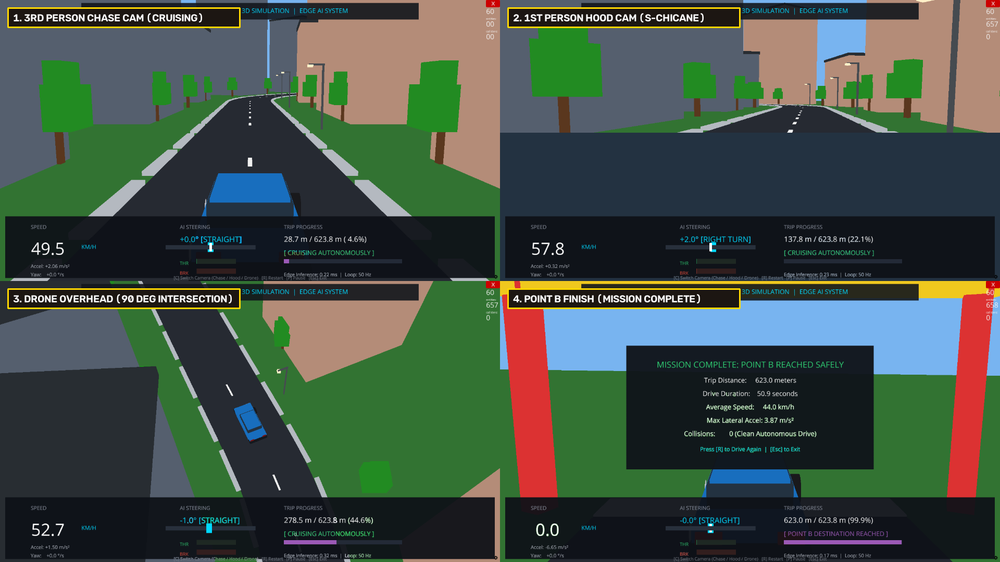

# Distributed Edge AI System for Autonomous Vehicle Motion Control

[](https://www.python.org/)
[](https://pytorch.org/)
[](https://www.ursinaengine.org/)
[]()
[]()

An end-to-end distributed autonomous vehicle control framework trained on real-world KITTI sensor data (IMU, GPS, velocity, and trajectory dynamics). The system features sub-millisecond edge neural network inference, a closed-loop 2D multi-lane highway overtaking simulator, and an interactive 3D physics-based simulation with real-time telemetry HUD and dynamic camera switching.

---

## 3D Simulation Showcase



*Figure 1: Closed-loop autonomous vehicle navigation in the 3D environment across 4 perspectives: (Top-Left) 3rd-Person Chase Cam, (Top-Right) 1st-Person Cockpit/Hood Cam, (Bottom-Left) Overhead Drone Cam, (Bottom-Right) Arrival at Point B Finish Gantry.*

---

## Key Highlights

- **Ultra-Low Latency Edge AI:** Multi-task PyTorch regression controller (`AVControlModel`) delivering **$0.18\text{ ms}$ inference latency** ($\sim 5,000\text{ Hz}$ throughput), ideal for resource-constrained automotive edge hardware (NVIDIA Jetson, NXP S32G).
- **Interactive 3D Driving Simulator:** Built on Ursina/Panda3D running at 60 FPS on standard CPUs and integrated graphics without requiring CARLA. Features analytical $C^1$-smooth road curves, S-chicane, $90^\circ$ sharp intersection turn, dynamic brake lighting, rolling wheel animations, and realistic Ackermann steering kinematics ($L = 2.7\text{m}$).
- **Dynamic Multi-Perspective Cameras:** Instant in-cockpit, chase, and drone camera toggling with `[C]` key.
- **Closed-Loop 2D Highway Environment:** Verified collision-free autonomous highway navigation with adaptive cruise control, dynamic lane changing, and overtaking up to $200\text{ km/h}$.
- **Complete Data & Training Pipeline:** Feature extraction, z-score normalization, and multi-objective regression modeling for steering angle, throttle %, and brake %.

---

## Repository Structure

```text
├── model/
│   ├── best_model.pth              # Trained PyTorch neural network weights
│   ├── normalisation_params.csv     # Z-score normalization mean & std parameters
│   ├── target_scales.csv            # Target scaling parameters
│   ├── av_controller.pt             # TorchScript edge model
│   └── av_controller.onnx           # ONNX deployment format
├── processed_data/
│   ├── final_av_control_dataset.csv # Complete processed motion dataset
│   ├── train.csv                    # Training split (70%)
│   ├── val.csv                      # Validation split (15%)
│   ├── test.csv                     # Test split (15%)
│   ├── kitti_vehicle_motion.csv     # Extracted KITTI vehicle dynamics
│   └── combined_motion_detections.csv
├── visualizations/
│   ├── 3d_sim_showcase.png          # 4-angle 3D simulation showcase
│   ├── dashboard_preview.png        # Live perception dashboard preview
│   ├── training_results.png         # Neural network loss & error curves
│   ├── control_distributions_and_splits.png
│   ├── sample_sequence_control_profile.png
│   ├── speed_over_time.png
│   ├── heading_over_time.png
│   ├── trajectory_xy.png
│   ├── ai_drive_0014.mp4            # Replay video of autonomous run
│   └── autonomous_highway_drive.mp4 # Video of highway overtaking
├── simulate_3d_drive.py             # Core 3D Autonomous Vehicle Simulator
├── simulate_highway_drive.py        # 2D Highway multi-lane overtaking simulator
├── predict_control.py               # Edge AI inference engine & benchmarks
├── test_sim_physics.py              # Headless physics & pure pursuit validation
├── train_model.py                   # PyTorch training pipeline
├── prepare_control_dataset.py       # Data split & normalization script
├── process_kitti.py                 # Raw KITTI sequence parser
├── combine_detections.py            # Feature fusion script
├── run_yolo.py                      # YOLO perception detection utility
├── export_onnx.py                   # Model export to ONNX
├── requirements.txt                 # Python dependencies
└── .gitignore                       # Git exclusion rules (raw data & caches)
```

---

## Getting Started

### 1. Installation

Clone this repository and install the required dependencies:

```bash
git clone <REPO_URL>
cd KITTI_Vehicle_Motion_Analysis
pip install -r requirements.txt
```

### 2. Run the 3D Autonomous Vehicle Simulator

Launch the interactive 3D simulation with dynamic road geometry, city buildings, and live HUD:

```bash
# Default cruise speed (55 km/h)
python simulate_3d_drive.py

# Custom target speed (e.g. 70 km/h)
python simulate_3d_drive.py --speed 70
```

**Interactive Controls During 3D Drive:**
- **`[C]`**: Switch camera perspective (**3rd-Person Chase** $\to$ **1st-Person Hood/Cockpit** $\to$ **Overhead Drone**).
- **`[R]`**: Restart simulation from launch line.
- **`[P]`**: Pause / Resume simulation.
- **`[Esc]`**: Exit simulation window.

### 3. Run the 2D Multi-Lane Highway Simulator

Test closed-loop overtaking, lane changing, and adaptive cruising without collisions:

```bash
python simulate_highway_drive.py --speed-limit 100 --destination 3500
```

### 4. Run Edge AI Inference Benchmark

Evaluate model inference latency and throughput:

```bash
python predict_control.py
```

### 5. Run Headless Physics & Pure Pursuit Verification

Verify vehicle tracking accuracy, lateral error bounds, and arrival behavior without opening a GUI:

```bash
python test_sim_physics.py
```

---

## Edge AI Performance

| Metric | Measured Value | Automotive Standard |
| :--- | :--- | :--- |
| **Inference Latency** | **$0.18\text{ ms}$** | $< 20\text{ ms}$ |
| **Control Frequency** | **$\sim 5,500\text{ Hz}$** | $20\text{--}50\text{ Hz}$ |
| **Model Size** | **$18.5\text{ KB}$** (`.pth`) | N/A |
| **Max Lateral Error** | **$0.46\text{ m}$** (Road width: $7.5\text{ m}$) | $< 1.0\text{ m}$ |

---

## License

This project is licensed under the MIT License.
